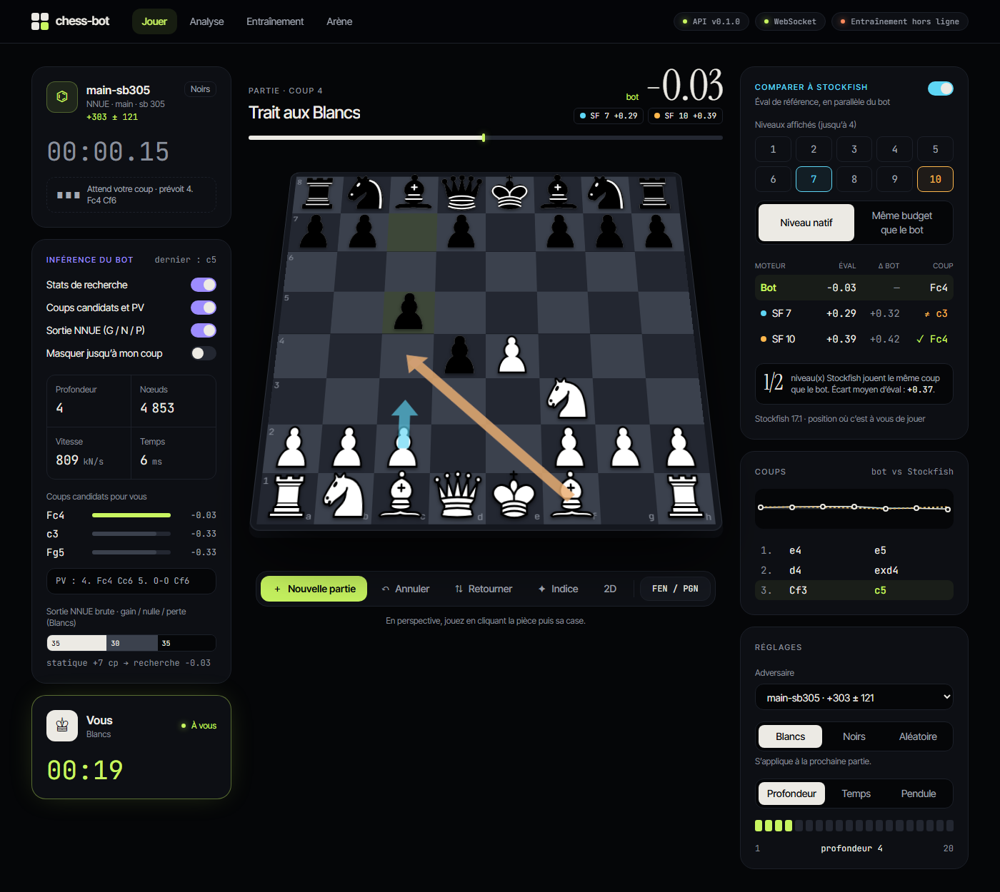
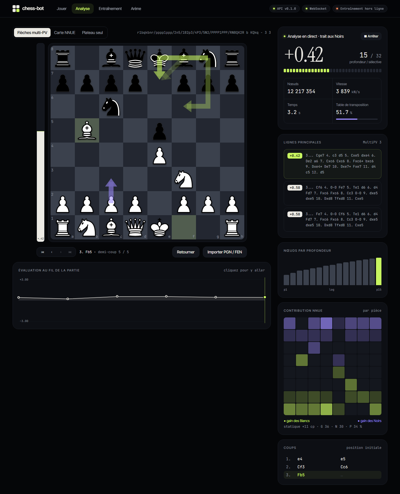
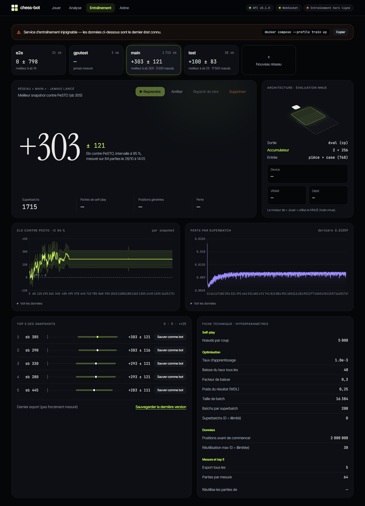
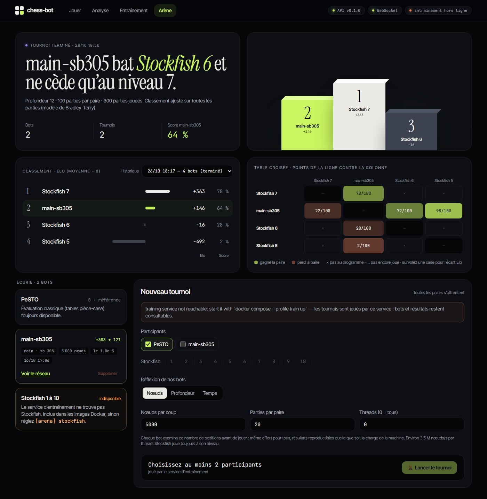
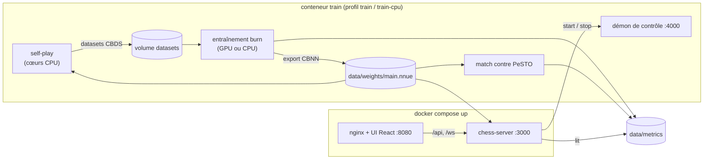

# chess-bot

Moteur d'échecs en Rust qui apprend en jouant contre lui-même :

1. **Moteur** : bitboards, recherche alpha-beta (PVS), évaluation NNUE incrémentale (AVX2), compatible UCI.
2. **Entraînement** : self-play et entraînement d'un réseau NNUE avec [burn](https://burn.dev), sur GPU NVIDIA avec repli automatique sur le CPU.
3. **Visualisation** : interface web (React + TypeScript) pour jouer, analyser et piloter l'entraînement.

| Jouer | Analyser | Entraîner | Arène |
| --- | --- | --- | --- |
| [](docs/screenshots/play.png) | [](docs/screenshots/analysis.png) | [](docs/screenshots/training.png) | [](docs/screenshots/arena.png) |

## Sommaire

- [Guide de démarrage](#guide-de-démarrage)
- [Prérequis](#prérequis)
- [Commandes](#commandes)
- [Architecture](#architecture)
- [Interface web et API](#interface-web)
- [Entraînement (NNUE)](#entraînement-nnue)
- [Analyse Chess.com](#analyse-chesscom)
- [Performances](#performances)
- [Utiliser le moteur dans une GUI](#utiliser-le-moteur-dans-une-gui-cute-chess-arena)
- [Dépannage](#dépannage)

## Guide de démarrage

Seul Docker est nécessaire (voir [Prérequis](#prérequis) selon l'OS).

**1. Lancer l'interface.**

```sh
git clone <ce dépôt> chess-bot && cd chess-bot
docker compose up --build
```

Le premier build compile le workspace Rust et le front : il prend plusieurs minutes, les suivants réutilisent le cache. Ouvrez ensuite <http://localhost:8080>.

**2. Jouer et analyser.** Sur la page **Jouer**, choisissez la couleur et le niveau, puis jouez en glisser-déposer ou clic-clic. La page **Analyse** importe une FEN ou un PGN et montre en direct l'évaluation, la ligne principale et le meilleur coup. Tant qu'aucun réseau n'a été entraîné, le moteur évalue avec PeSTO (tables pièce-case classiques).

**3. Vérifier le GPU** (facultatif, NVIDIA seulement).

```sh
just gpu-check      # ou : docker compose --profile train run --rm --build train gpu-check
```

La commande affiche `nvidia-smi`, puis fait calculer burn sur le GPU et compare au CPU. Sans GPU, passez à l'étape suivante avec `train-cpu`.

**4. Entraîner le réseau.** Arrêtez la pile (Ctrl+C), puis relancez-la avec le profil d'entraînement :

```sh
docker compose --profile train up --build        # GPU NVIDIA (repli CPU si aucun GPU visible)
docker compose --profile train-cpu up --build    # sans CUDA (macOS, machines sans NVIDIA)
```

Le pipeline démarre seul :

- le self-play produit des positions sur les cœurs CPU ;
- l'entraînement commence après 2 millions de positions, soit quelques minutes ;
- chaque export du réseau est mesuré contre PeSTO.

La page **Entraînement** affiche la progression : perte, vitesse, VRAM, Elo. Elle permet aussi d'arrêter, de reprendre ou de repartir d'un réseau vierge.

**5. Jouer contre le réseau.** Rien à faire : le serveur recharge `data/weights/main.nnue` à chaque export, et la tuile « Évaluation du moteur » passe de PeSTO à NNUE. La courbe d'Elo suit sa force par rapport à PeSTO. Sur la machine de référence, le réseau est au niveau de PeSTO dès les premiers exports et mesure +100 ± 83 Elo après 35 superbatchs, soit environ 30 minutes ; la capture ci-dessus vient de ce run. Avec 64 parties par mesure, l'intervalle reste large : `chess-train match` donne une mesure plus précise.

**6. Arrêter et reprendre.** `docker compose --profile train stop` (ou le bouton « Arrêter ») termine l'étape en cours et écrit un checkpoint. Un `docker compose --profile train up` ultérieur reprend exactement où l'entraînement s'était arrêté. Tout ce qui compte se trouve dans `./data` (poids, checkpoints, métriques) et dans le volume Docker `datasets`.

Le réseau entraîné est un fichier ordinaire : `data/weights/main.nnue` s'utilise aussi dans Cute Chess ou Arena (voir [Utiliser le moteur dans une GUI](#utiliser-le-moteur-dans-une-gui-cute-chess-arena)).

## Prérequis

| OS | À installer |
| --- | --- |
| **Windows 10/11** | [Docker Desktop](https://www.docker.com/products/docker-desktop/) avec le backend **WSL2**. Pour le GPU : un pilote NVIDIA récent pour Windows. Ne pas installer de pilote dans WSL : Docker Desktop expose le GPU tout seul. |
| **Linux** | Docker Engine + plugin Compose. Pour le GPU : le pilote NVIDIA et le [NVIDIA Container Toolkit](https://docs.nvidia.com/datacenter/cloud-native/container-toolkit/latest/install-guide.html) (`nvidia-ctk runtime configure --runtime=docker`). |
| **macOS** | Docker Desktop. Pas de CUDA : l'entraînement passe par `train-cpu`. |

Pour développer hors Docker : [rustup](https://rustup.rs) (la version est fixée par `rust-toolchain.toml`), [just](https://just.systems), et Node.js ≥ 22 pour le front.
Sous Windows : `winget install Rustlang.Rustup Casey.Just OpenJS.NodeJS.LTS`, plus les *Build Tools* MSVC.

**Performances sous Windows.** Les builds Docker et les lectures disque sont nettement plus rapides si le dépôt est cloné dans le système de fichiers WSL (`\\wsl$\Ubuntu\home\...`) plutôt que sur `C:\`. Si le dépôt reste sur `C:\`, les datasets (lus en continu pendant l'entraînement) sont de toute façon placés dans un volume Docker nommé, `datasets`, qui vit côté Linux.

**Permissions sous Linux.** Les conteneurs tournent sous un utilisateur non-root (UID 10001). Pour que les fichiers écrits dans `./data` vous appartiennent, lancez `export CHESS_UID=$(id -u) CHESS_GID=$(id -g)` avant `docker compose`.

## Commandes

`just` liste toutes les recettes. Les principales :

| Commande | Effet |
| --- | --- |
| `docker compose up` / `just up` | serveur + UI sur <http://localhost:8080> |
| `just train` (`docker compose --profile train up -d --build`) | UI + entraînement sur GPU (image CUDA), en arrière-plan |
| `just train-cpu` | UI + entraînement sur CPU (image sans CUDA), en arrière-plan |
| `just logs [service]` | suit les logs de `train` (par défaut), `train-cpu`, `server` ou `web` |
| `just down` | arrête tout, entraînement compris (checkpoint écrit) |
| `just train-run <commande>` | une commande `chess-train` ponctuelle dans l'image CUDA (`match`, `export`…) |
| `just gpu-check` | `nvidia-smi` dans un conteneur, puis un matmul et une rétropropagation burn sur le GPU, comparés au CPU |
| `just web-dev` | Vite (rechargement à chaud) + `chess-server` natif, sans reconstruire d'image |
| `just test` / `just lint` / `just ci` | tests, vérifications de la CI (rustfmt, clippy `-D warnings`, ESLint, tsc, Prettier), ou les deux |
| `just perft` | perft profond en release (positions CPW + cas limites, ~790M nœuds, quelques secondes) |
| `just bench` | benchmarks criterion : génération de coups, recherche, inférence NNUE |
| `just engine-bench` | signature et vitesse (nœuds/s) du moteur, via `chess-uci bench` |
| `just play` | moteur UCI sur stdin/stdout |
| `just gen-types` | régénère les types TypeScript depuis les structs Rust |
| `just chesscom <pseudo> [options]` | synchronise les parties Chess.com d'un joueur dans le cache et les liste (voir [Analyse Chess.com](#analyse-chesscom)) |

## Architecture

```
crates/
  chess-core/    plateau, bitboards, coups, FEN/PGN, Zobrist (aucune I/O, aucune dépendance projet)
  chess-eval/    trait Evaluator + évaluation classique (PeSTO) + inférence NNUE (AVX2 / portable)
  chess-search/  alpha-beta générique sur Evaluator (ne voit que le trait), multi-PV
  chess-stockfish/ pilote UCI de Stockfish : bridé en 10 niveaux (arène, comparaisons) ou pleine force en MultiPV (analyses)
  chess-uci/     binaire UCI
  chess-train/   binaire : self-play, entraînement burn (CUDA ou CPU), matchs, démon de contrôle
  chess-server/  binaire : API REST (OpenAPI) + WebSocket (axum)
  chess-chesscom/ client de l'API publique Chess.com (requêtes en série, retry, PGN + horloges)
  chess-openings/ noms d'ouvertures (base lichess, CC0) reconnus par position, coups « book »
  chess-review/  analyse d'une partie : trait AnalysisEngine (Stockfish UCI, notre moteur), MultiPV,
                 classification des coups, précision (formules Lichess), motifs, Elo estimé
  chess-reviewer/ cache SQLite des parties et des analyses, synchronisation, jobs et workers, profil,
                 calibration de l'Elo, CLI
web/             React + TypeScript + Vite + Tailwind
docker/          Dockerfiles (engine, train, web) + nginx.conf
config/          configuration de l'analyse Chess.com (review.toml)
data/            poids, checkpoints, métriques, cache (ignoré par git)
```



- **Règles de dépendance.** `chess-search` dépend de `chess-eval` avec `default-features = false` et ne voit donc que le trait `Evaluator`. La CI lance `cargo check -p chess-search` seul pour le garantir. Seuls les binaires font de l'I/O, du logging et de la configuration.
- **Évaluation incrémentale.** Le trait `Evaluator` porte un état propre à chaque recherche, mis à jour à chaque make/unmake. Pour le NNUE, c'est une pile d'accumulateurs `i16` : chaque coup écrit l'accumulateur de l'enfant à partir de celui du parent, en ajoutant et retirant les lignes de poids des pièces déplacées. Les noyaux AVX2 sont choisis à l'exécution ; une version portable, découpée de la même façon, est vectorisée par le compilateur (SSE2, NEON). Les deux donnent des résultats identiques au bit près, ce que vérifient les tests.
- **Types partagés.** Les structs de l'API dérivent `ts_rs::TS`. `cargo test` écrit leur équivalent TypeScript dans `web/src/api/generated/`, et la CI échoue si ces fichiers ne sont pas à jour.
- **Une seule origine.** Nginx (Docker) ou Vite (dev) sert l'UI et proxifie `/api` et `/ws` vers `chess-server`. Il n'y a donc pas de CORS.
- **GPU.** `chess-train` est compilé avec la feature `cuda` dans l'image GPU. Au démarrage, il cherche le pilote CUDA sans risquer de panic, puis utilise le GPU, ou le CPU (backend burn `flex`) s'il n'en trouve pas. Le device retenu est toujours affiché. cubecl compile les kernels lui-même (LLVM → PTX) : ni nvcc ni NVRTC ne sont nécessaires, et le build CUDA se fait dans l'image `nvidia/cuda:*-base`. L'image `devel` reste possible avec `--build-arg CUDA_BUILD_FLAVOR=devel`.

### Configuration de `chess-server`

Ordre de priorité : valeurs par défaut < fichier TOML (`chess-server.toml`, ou le chemin donné par `CHESS_SERVER_CONFIG`) < variables `CHESS_SERVER_*`.

```toml
bind = "0.0.0.0:3000"
data_dir = "data"
log_format = "pretty"   # ou "json"
max_searches = 8        # recherches simultanées (défaut : nombre de cœurs)
engine_hash_mb = 16     # table de transposition de chaque recherche
eval_file = "data/weights/main.nnue"   # réseau utilisé dès qu'il existe (rechargé à chaque export)
stockfish = "stockfish" # binaire pour les comparaisons de la page Jouer (inclus dans l'image Docker)
# trainer_url = "http://trainer:4000"  # démon de contrôle de l'entraînement (défini en Docker)
```

Le niveau de log se règle avec `RUST_LOG` (ex. `RUST_LOG=debug`).

## Interface web

<http://localhost:8080> (Docker) ou <http://localhost:5173> (`just web-dev`).

- **Jouer** : échiquier en perspective (clic-clic) ou à plat (glisser-déposer aussi), choix de l'**adversaire** (réseau en service, PeSTO ou un bot sauvegardé, aussi depuis l'Arène), de la couleur (blancs, noirs, aléatoire) et du niveau : profondeur (1 à 20), temps par coup (0,1 à 10 s) ou **pendule** (1 + 0 à 15 + 10 : le bot gère son temps comme en partie réelle, la chute du drapeau perd). Annulation de coup, **indice** (flèche du meilleur coup), import/export FEN et PGN. Autour du plateau :
  - l'inférence du bot (profondeur, nœuds, vitesse), vos **3 coups candidats** et leur PV, la **sortie NNUE brute** en gain / nulle / perte, le tout masquable jusqu'à votre coup ;
  - la **comparaison avec Stockfish** : jusqu'à 4 niveaux, à leur budget natif ou au même budget que le bot, avec leur éval, l'écart au bot, leur coup (flèches de couleur) et leurs courbes à côté de celle du bot.
  Les coups sont écrits en notation française (C, F, T, D, R).
- **Analyse** : barre d'évaluation, score, les **3 lignes principales** (MultiPV) et leurs flèches, la réponse attendue, la **carte NNUE** (ce que chaque pièce apporte à l'évaluation, sur le plateau ou en grille), infos de recherche en direct (profondeur, nœuds, vitesse, remplissage de la table), nœuds par profondeur et courbe d'évaluation de la partie (un clic y amène). L'analyse est relancée à chaque coup. On navigue dans la partie avec les flèches ← → (Origine et Fin pour aller au début ou à la fin), ou en cliquant dans la liste des coups.
- **Entraînement** : les réseaux de neurones en cartes, avec leur meilleur Elo. Si le service est arrêté, un bandeau donne la commande pour le lancer. « Nouveau réseau » ouvre un formulaire : nom, hyperparamètres (pré-remplis avec les valeurs par défaut ou celles d'un autre réseau, ou **tirés au hasard** avec « Hyperparamètres aléatoires ») et réseaux dont on réutilise les parties. Pour le réseau sélectionné, on trouve :
  - son meilleur Elo contre PeSTO et son état (device, phase, parties, positions, superbatchs, perte, vitesse, VRAM) ;
  - sa fiche technique (hyperparamètres) ;
  - le **mur de self-play** : un plateau par worker, en direct pendant l'entraînement ;
  - son **top 5** des snapshots, chacun sauvegardable comme bot ;
  - ses courbes de perte et d'Elo contre PeSTO ;
  - les boutons « Démarrer / reprendre », « Arrêter », « Repartir de zéro » et « Supprimer » ;
  - un **minuteur** : on démarre pour une durée donnée (15 min à 24 h, ou un nombre de minutes au choix, jusqu'à une semaine). À l'échéance, l'entraînement s'arrête comme avec « Arrêter » : il finit l'étape en cours, écrit un checkpoint et exporte le réseau. Pendant l'entraînement, un compte à rebours indique l'heure d'arrêt ; on peut la modifier ou retirer le minuteur.
- **Arène** : les bots sauvegardés, plus PeSTO et **Stockfish niveaux 1 à 10**, et les **tournois** toutes-rondes entre eux : choix des participants, des parties par paire et de la réflexion de nos bots (nœuds, profondeur ou temps par coup). La **table croisée des participants** permet d'activer ou de désactiver chaque combat avant le lancement, par exemple pour ne faire jouer tes réseaux que contre Stockfish. Un clic sur un nom bascule tous ses combats, et des boutons permettent de tout activer ou de tout désactiver. Avant le lancement, le formulaire affiche la **durée estimée** du tournoi. Une fois lancé, un tournoi affiche sa progression en direct, un résumé (par exemple « main-sb305 bat Stockfish 6 et ne cède qu'au niveau 7 »), un podium, un classement Elo, une table croisée et l'historique des tournois.
- **Chess.com** : le **profil** d'un joueur. On saisit un pseudo et des filtres : cadences, nombre de parties, période, parties classées seulement. Le panneau d'analyse affiche, pour chaque preset, la durée estimée et le nombre de parties à analyser. Un bouton télécharge et analyse ces parties, avec une barre de progression en direct et le temps restant ; l'analyse peut être annulée. Le tableau de bord détaille ensuite :
  - le bilan, la précision et l'ACPL moyens, l'Elo, et la répartition des coups par classe ;
  - les **3 points faibles** principaux, avec des exemples cliquables qui ouvrent la partie à la position du coup ;
  - les erreurs et le temps par **phase** (ouverture, milieu, finale), la **gestion du temps**, la **conversion** des positions gagnantes et la **défense** des positions perdues ;
  - les **motifs** des erreurs ;
  - le **répertoire** avec chaque couleur, avec le score et la précision ;
  - les **positions qui reviennent**, avec le coup joué et le bon coup ;
  - enfin la liste des parties avec la précision de chacune.

  Une partie s'ouvre dans une **revue de partie** (voir [Analyse Chess.com](#analyse-chesscom)) :
  - un plateau navigable (boutons, flèches du clavier, clic sur un coup ou sur le graphe) avec les deux joueurs et leurs pendules `[%clk]` ;
  - les cases du coup joué prennent la couleur de sa classe. Une flèche montre le meilleur coup de la position ; après une imprécision ou pire, une seconde flèche montre ce qu'il fallait jouer ;
  - un graphe cliquable des chances de gain des Blancs, avec un repère sur chaque coup notable (brillant, très bon coup, imprécision, erreur, occasion manquée, gaffe) ;
  - la liste des coups avec ces mêmes repères, le verdict du coup courant (classe, chances avant et après, précision, perte), les meilleures lignes de la position, et pour chaque joueur la précision, l'ACPL et le nombre de coups par classe ;
  - le nom de l'ouverture.

Les boutons de ces deux pages passent par le démon de contrôle : il faut le profil `train` ou `train-cpu`. Sans lui, réseaux, bots et résultats restent consultables.

Le front ne contient aucune règle d'échecs : chaque coup est validé par le moteur, qui renvoie aussi les coups légaux, le SAN et l'état de la partie.

### API

Documentation OpenAPI complète : `GET /api/openapi.json`.

L'API est **sans état** : une partie est toujours envoyée sous la forme `{ "fen": "<départ, optionnel>", "moves": ["e2e4", ...] }`, et le serveur la rejoue et la valide (erreur 422 avec un message en cas de coup illégal).

| Route | Rôle |
| --- | --- |
| `GET /api/health` | état et version du serveur |
| `POST /api/position` | rejoue une partie : FEN, coups légaux (UCI + SAN), échec, statut, historique SAN |
| `POST /api/engine/move` | coup du moteur, avec limites `depth`, `movetimeMs`, `nodes` (1 s par défaut) ou les pendules (`whiteTimeMs`, `blackTimeMs`, `whiteIncrementMs`, `blackIncrementMs`), `multipv` (1 à 5 lignes) et `bot` (un bot sauvegardé, `classic` pour PeSTO) |
| `POST /api/engine/explain` | évaluation statique décomposée : sortie brute, estimation gain / nulle / perte, apport de chaque pièce (NNUE) |
| `POST /api/stockfish/compare` | coup et éval de 1 à 4 niveaux de Stockfish (`{"game", "levels", "budget"}`, `budget` absent : budget natif) ; 503 sans Stockfish |
| `POST /api/pgn/import` | première partie d'un PGN |
| `POST /api/pgn/export` | partie au format PGN |
| `GET /api/engine` | évaluation utilisée par le moteur (`nnue` ou `classic`, fichier de poids) |
| `GET /api/training?network=<nom>` | état du démon, liste des réseaux (hyperparamètres, top 5), statut et courbes du réseau demandé |
| `GET /api/training/selfplay` | plateau de chaque worker de self-play (`live` tant qu'il tourne) |
| `POST /api/training/start` | entraîne un réseau (`{"network": "exp", "fresh": false}`) ; 409 si un entraînement est déjà en cours |
| `POST /api/training/stop` | arrête le pipeline après l'étape en cours (checkpoint écrit) |
| `POST /api/training/timer` | fixe, déplace ou retire le minuteur de l'entraînement en cours (`{"minutes": 90}` ou `{"minutes": null}`) ; `maxMinutes` au démarrage |
| `GET /api/networks/defaults` | hyperparamètres d'un nouveau réseau |
| `POST /api/networks`, `DELETE /api/networks/{nom}` | crée un réseau (`{"name", "params"}`, 422 si un paramètre est hors bornes), le supprime |
| `GET /api/arena` | bots et derniers tournois |
| `GET /api/bots` | bots sauvegardés |
| `POST /api/bots`, `DELETE /api/bots/{nom}` | sauvegarde un snapshot comme bot (`{"name", "network", "superbatch"}`), le supprime |
| `POST /api/tournaments`, `POST /api/tournaments/stop` | lance un tournoi (`{"bots", "gamesPerPair", "limit": {"kind": "nodes" | "depth" | "time", "value"}, "threads", "pairings": [{"a", "b"}] | null}`, où `null` signifie tous les combats), l'arrête |
| `GET /api/review/options` | presets d'analyse (Rapide, Équilibré, Approfondi), moteur et preset par défaut, workers, limites |
| `POST /api/review/estimate` | durée estimée de l'analyse des parties demandées pour chaque preset (et pour les réglages de la requête) : parties déjà en cache, positions à analyser, secondes par position (mesurées sur de vraies analyses, sinon sur un court benchmark) |
| `POST /api/review/jobs` | lance l'analyse des parties Chess.com d'un joueur (`{"username", "timeClasses", "maxGames", "since", "until", "ratedOnly", "engine": "stockfish" \| "native", "preset", "depth" \| "movetimeMs", "multipv"}`, les trois derniers remplaçant ceux du preset) ; 202 avec `jobId`, 503 sans User-Agent |
| `GET /api/review/jobs/{id}`, `DELETE /api/review/jobs/{id}` | progression d'une analyse (mois lus, parties en cache, analysées, positions, temps restant `etaSeconds`), l'arrête |
| `GET /api/review/jobs/{id}/events` | la même progression en Server-Sent Events (`progress`, au plus toutes les 150 ms, jusqu'à l'état final) |
| `GET /api/review/players/{pseudo}/games` | parties en cache d'un joueur (`timeClasses`, `maxGames`, `since`, `until`, `ratedOnly`), sans rien télécharger |
| `GET /api/review/players/{username}/profile` | profil d'un joueur sur ses parties analysées (mêmes filtres) : bilan, précision, répertoire, positions récurrentes et bon coup, erreurs par phase, temps, conversion, motifs tactiques, 3 points faibles avec exemples, Elo estimé par cadence (intervalle à 95 %) face à l'Elo réel |
| `GET /api/review/games/{id}` | une partie : ouverture (ECO, nom, famille, variante), coups (SAN, horloges, `book`) et dernière analyse : éval, chances de gain et meilleures lignes de chaque position, classe et précision de chaque coup, précision, ACPL et nombre de coups par classe de chaque joueur |
| `GET /ws` | WebSocket : `analyze` (avec `limits.multipv` et `bot` en option) puis un message `info` par profondeur, avec ses lignes, et un `done` final ; `stop` interrompt l'analyse |

Les scores renvoyés sont du point de vue des blancs. Les limites sont plafonnées côté serveur (profondeur 64, 60 s par coup, 10 min d'analyse), et le nombre de recherches simultanées est borné par `max_searches`.

## Entraînement (NNUE)

Le réseau suit l'architecture `768 → 256 ×2 → 1` en perspective. Les entrées sont 768 features binaires (couleur relative × pièce × case), et un feature transformer commun alimente deux moitiés : celle du camp au trait et celle de l'adversaire. Les deux passent par un ReLU borné (CReLU) avant la couche de sortie.

```sh
docker compose --profile train up        # UI + API + entraînement GPU (repli CPU si aucun GPU)
docker compose --profile train-cpu up    # même chose sans CUDA
docker compose --profile train stop      # arrêt propre : l'étape en cours se termine, checkpoint écrit
```

Le service `train` lance le **démon de contrôle** (`chess-train serve --autostart`). Celui-ci démarre aussitôt le pipeline du dernier réseau ; ensuite, les pages **Entraînement** et **Arène** de l'UI le pilotent via `chess-server`. C'est le démon qui écrit dans `data/` ; le serveur ne fait que lire. Le pipeline fait tourner **le self-play sur les cœurs CPU** (producteur) et **l'entraînement sur le GPU** (consommateur) en même temps :

1. **Self-play.** Le moteur joue contre lui-même (rayon, un searcher par thread) après 6 à 10 coups aléatoires, à 5 000 nœuds par coup, **avec le dernier réseau exporté**. Il le recharge dès qu'un nouvel export paraît, et utilise PeSTO tant qu'il n'y en a pas. On ne garde que les positions calmes : pas d'échec, meilleur coup non tactique. Une partie s'arrête par adjudication quand les deux camps s'accordent sur le résultat.
2. **Dataset.** Chaque position est un enregistrement fixe de 32 octets (format `CBDS` v1, décrit dans `crates/chess-train/src/dataset/mod.rs`), écrit par fichiers d'un million de positions publiés de façon atomique. Les datasets vivent dans le volume Docker `datasets`.
3. **Entraînement.** Les fichiers sont **lus en continu depuis le disque**, par blocs mélangés, sans jamais tenir entièrement en mémoire. Les batchs de 16 384 positions arrivent sous forme **creuse** : 32 indices de features par position, au lieu de 768 flottants. Les entrées one-hot sont reconstruites sur le GPU par un scatter. Optimiseur AdamW, perte `(σ(sortie) − cible)²`, où la cible mélange le score de recherche et le résultat de la partie. Les poids restent bornés pour que la quantification ne puisse pas déborder. L'entraînement va bien plus vite que le self-play (environ 1,5 M positions/s contre 10 000/s). Le pipeline borne donc la réutilisation : chaque position sert en moyenne au plus 30 fois (`max_reuse`), et au-delà l'entraînement attend de nouvelles parties au lieu de sur-apprendre les anciennes.
4. **Checkpoints.** À chaque superbatch (200 pas), `data/checkpoints/<run>/` reçoit les poids flottants avec leurs identifiants de paramètres, l'état AdamW et la progression. La reprise est exacte et se fait par défaut. L'option `--fresh` (ou le bouton « Repartir de zéro ») repart de zéro et efface le top 5 du réseau.
5. **Export.** Les poids quantifiés au format `CBNN` v1 attendu par `chess-eval` (décrit dans `crates/chess-eval/src/nnue/mod.rs`) vont dans `data/weights/<run>.nnue`, avec un instantané `data/weights/<run>/sbNNNNN.nnue` tous les 5 superbatchs. **Le serveur recharge ce fichier automatiquement** : dès le premier export, on joue et on analyse contre le réseau.
6. **Elo et top 5.** Chaque export est mesuré contre l'évaluation classique (PeSTO), en 64 parties jouées par paires couleurs inversées, sur 2 threads. On obtient la courbe d'Elo entre checkpoints. Les 5 meilleurs snapshots mesurés sont classés dans `data/weights/<run>/best.json` ; les autres snapshots mesurés sont supprimés (`keep_best` dans `[evaluation]`).
7. **Métriques.** `data/metrics/events.jsonl` reçoit une ligne par événement (perte, vitesse, VRAM, checkpoints, exports, matchs) et `data/metrics/status.json` donne l'état courant. La page Entraînement les affiche.

Les étapes sont aussi disponibles séparément, en Docker (`just train-run <commande>`) ou en natif :

```sh
chess-train gpu-check                          # device utilisé ; matmul, sigmoïde, rétropropagation vérifiés
chess-train selfplay --games 10000             # génère un dataset (--network net.nnue pour jouer avec un réseau)
chess-train train --superbatches 50            # entraîne sur tout le dossier de datasets
chess-train pipeline --max-minutes 120         # self-play + entraînement, arrêt propre au bout de 2 h
chess-train export --out net.nnue              # quantifie le dernier checkpoint
chess-train match new.nnue old.nnue --games 400 --sprt --elo0 0 --elo1 10
chess-train match data/weights/main.nnue stockfish-5 --games 100 --movetime 100   # ou --nodes, --depth
chess-train serve --port 4000                  # démon de contrôle (GET /status, POST /start, POST /stop)
```

`match` joue des paires de parties sur la même ouverture aléatoire, couleurs inversées, avec la même réflexion pour nos moteurs : un nombre de nœuds par coup fixe par défaut, ou `--depth` / `--movetime` (Stockfish joue à son niveau). Il affiche l'Elo avec son intervalle à 95 % et la LOS. Avec `--sprt`, il s'arrête dès que le test conclut (approximation normale du modèle trinomial, comme fishtest ; α = β = 0,05 par défaut). `classic` désigne l'évaluation PeSTO, et `stockfish-1` à `stockfish-10` les niveaux de Stockfish.

La configuration se fait par `chess-train.toml` (voir [`chess-train.example.toml`](chess-train.example.toml)), par les variables `CHESS_TRAIN_*` (`CHESS_TRAIN_SELFPLAY__NODES=8000`) ou par les options de la ligne de commande.

### Plusieurs réseaux, bots et tournois

- **Réseau.** Un réseau est un run nommé, qui possède ses propres hyperparamètres dans `data/runs/<nom>.json`. Un réseau reprend toujours avec les réglages de sa création. Il a aussi son propre checkpoint, ses poids (`data/weights/<nom>.nnue`, snapshots dans `data/weights/<nom>/`) et ses parties (`<nom>-NNNN` dans le volume `datasets`).
  - On peut changer les nœuds de self-play, le taux d'apprentissage et sa décroissance, le poids du résultat (WDL), la taille de batch, le nombre de batchs par superbatch, la durée, le seuil de démarrage, la réutilisation maximale, la fréquence d'export et le nombre de parties de mesure.
  - L'architecture reste `768 → 256 ×2 → 1` : c'est le format lu par le moteur.
  - Un seul réseau s'entraîne à la fois, car le GPU et les cœurs sont partagés.
  - **Réutiliser les parties de** : le nouveau réseau s'entraîne aussi sur les parties d'autres réseaux. Il démarre ainsi sans attendre 2 M positions de son propre self-play, ce qui est pratique pour comparer des hyperparamètres d'entraînement sur les mêmes données.
- **Bot.** Un bot est un snapshot copié dans `data/bots/<nom>.nnue`, avec sa description (`<nom>.json` : réseau d'origine, superbatch, Elo mesuré, hyperparamètres). Il ne bouge plus, même si le réseau continue de s'entraîner ou est supprimé.
- **Tournoi.** Chaque paire de bots joue les mêmes ouvertures aléatoires avec les deux couleurs, et tous nos bots réfléchissent pareil : seule l'évaluation les distingue. La réflexion se règle de trois façons :
  - **Nœuds** (par défaut) : chaque bot examine le même nombre de positions avant de jouer, soit environ 3,5 M nœuds/s par thread. Les résultats sont reproductibles quelle que soit la charge de la machine.
  - **Profondeur** : chaque bot cherche jusqu'à la même profondeur (1 à 30 demi-coups). Le temps par coup varie beaucoup selon la position.
  - **Temps** : chaque bot réfléchit le même temps par coup (10 ms à 60 s). Une évaluation plus rapide cherche alors plus loin, ce qui correspond aux conditions de jeu réelles, mais un entraînement en parallèle ralentit tout le monde.

  Le classement ajuste un Elo sur toutes les parties (modèle de Bradley-Terry), avec PeSTO à 0 quand il participe. Si des combats sont désactivés, deux groupes de bots qui ne se rencontrent jamais n'ont pas d'échelle commune, et le formulaire le signale. Un bot sans aucun combat est retiré du tournoi. Les résultats sont écrits au fil des parties dans `data/tournaments/<id>.json`. Un tournoi peut tourner pendant un entraînement : il prend alors du CPU au self-play (réglable avec « Threads »).
- **Durée estimée.** L'estimation vient d'un modèle calé sur des mesures faites sur la machine de référence :
  - parties d'environ 100 demi-coups, adjudication comprise ;
  - environ 3,5 M nœuds/s par thread ;
  - une profondeur qui coûte environ ×1,9 par demi-coup supplémentaire ;
  - une limite en temps dépassée d'environ 10 % ;
  - un temps par coup mesuré pour chaque niveau de Stockfish (les niveaux 7 à 10 utilisent tout le leur).

  Le modèle tient compte de la répartition des parties sur les threads, paire par paire. Sur des tournois réels, il tombe à ±30 % ; un entraînement en parallèle allonge tout.
- **Hyperparamètres aléatoires.** Le bouton tire au hasard des valeurs dans des plages raisonnables : nœuds de self-play entre 2 000 et 20 000 et taux d'apprentissage entre 1e-4 et 3e-3 (tous deux en échelle log), décroissance du taux, poids du résultat, taille de batch et réutilisation. La durée, le seuil de démarrage et la mesure ne changent pas. On peut ainsi lancer plusieurs réseaux différents, sauvegarder leurs meilleurs snapshots et les départager en tournoi.
- **Stockfish 1 à 10.** Stockfish 19 (inclus dans les images Docker) joue à un niveau bridé, à la manière de lichess. Il ignore la réflexion choisie pour nos bots et joue avec un niveau de jeu (`Skill Level`, qui choisit parfois exprès un coup plus faible), une profondeur et un temps par coup qui augmentent ensemble. Les niveaux 1 à 8 cherchent aussi profond et aussi longtemps que les 8 niveaux de lichess ; 9 et 10 vont au-delà. Hors Docker, il faut indiquer le binaire avec `[arena] stockfish` (ou `CHESS_TRAIN_ARENA__STOCKFISH`) ; sans lui, les niveaux sont grisés.

  | Niveau | 1 | 2 | 3 | 4 | 5 | 6 | 7 | 8 | 9 | 10 |
  | --- | --- | --- | --- | --- | --- | --- | --- | --- | --- | --- |
  | Skill Level (0–20) | 0 | 2 | 4 | 6 | 8 | 10 | 13 | 16 | 18 | 20 |
  | Profondeur max | 1 | 1 | 2 | 3 | 5 | 8 | 13 | 22 | 26 | 30 |
  | Temps par coup | 50 ms | 100 ms | 150 ms | 200 ms | 300 ms | 400 ms | 500 ms | 1 s | 1,5 s | 2 s |

  Comme repère, sur la machine de référence, `main` (sb305, 5 000 nœuds par coup) s'est classé entre Stockfish 3 et Stockfish 5 : environ +45 Elo, contre +105 pour le niveau 5 et +243 pour le niveau 7, PeSTO étant à 0. Ce n'est qu'une estimation sur 8 parties par paire.

Au premier démarrage du démon, le top 5 des réseaux entraînés avant cette fonctionnalité est **reconstruit depuis l'historique des matchs**, et leurs autres snapshots mesurés sont supprimés. Pour tous les garder, il faut copier `data/weights/<run>/` ailleurs avant de mettre à jour.

## Analyse Chess.com

À partir d'un pseudo Chess.com : analyse de chaque partie (style *Game Review*) et bilan du profil sur les N dernières parties. Fonctionnalité en cours de construction ; disponible pour l'instant : la récupération et le cache des parties, et leur analyse par Stockfish (ou notre moteur), la reconnaissance des ouvertures, la classification des coups, la précision des joueurs, leur profil et l'estimation de leur Elo.

**User-Agent obligatoire.** Chess.com demande à tout client de son API publique un `User-Agent` explicite, avec un moyen de contacter son auteur. Copiez `.env.example` en `.env` et renseignez `CHESS_REVIEW_USER_AGENT`. Sans lui, rien n'est envoyé.

```powershell
just chesscom hikaru -n 20 --time-class blitz,rapid
cargo run -p chess-reviewer -- fetch hikaru -n 50 --since 2026-01-01 --until 2026-06-30 --rated
cargo run --release -p chess-reviewer -- estimate hikaru -n 10            # durée par preset
cargo run --release -p chess-reviewer -- analyse hikaru -n 10 --preset fast
cargo run --release -p chess-reviewer -- analyse hikaru -n 10 --depth 14 --multipv 2
docker compose exec server chess-reviewer analyse hikaru -n 10   # avec le Stockfish de l'image
```

- **Requêtes en série.** Chess.com autorise un accès illimité en série mais répond `429` aux requêtes parallèles. Le client n'envoie qu'une requête à la fois, espacées de `min_interval_ms`. Les réponses `429` et `5xx` et les erreurs réseau sont retentées avec un backoff exponentiel (avec jitter, en respectant `Retry-After`).
- **Cache** (`data/review/cache.sqlite`). Les mois passés ne changent plus : lus une fois après leur fin, ils ne sont plus jamais téléchargés à nouveau. La liste des mois et le mois en cours sont revalidés après `recent_ttl_secs` par requête conditionnelle (`ETag`, réponse `304`). La lecture va du mois le plus récent au plus ancien et s'arrête dès que le nombre de parties demandé est atteint. Seules les parties d'échecs standard sont gardées (pas de 960 ni de variantes).
- **PGN.** `chess-core` garde le commentaire de chaque coup. Les horloges `[%clk]` et le tag `TimeControl` (`180+2`, `1/86400` pour le Daily) sont décodés.
- **Ouvertures.** La base [lichess-org/chess-openings](https://github.com/lichess-org/chess-openings) (CC0, environ 3 900 lignes, figée sur un commit dans `crates/chess-openings/data`) est compilée dans le binaire. Chaque ligne nomme la position où elle aboutit. Les positions sont comparées par EPD (FEN sans les compteurs de coups) et non par suite de coups : `1. Nf3 Nf6 2. d4 d5 3. Bf4` est reconnu comme le Système de Londres (D02), comme `1. d4 d5 2. Nf3 Nf6 3. Bf4`. Une partie prend le nom de la position nommée la plus profonde qu'elle atteint. Ses premiers coups sont « book » tant que chacun mène à une position d'une ligne de la base. Les systèmes (Londres, Colle, Catalane, etc.) sont reconnus quel que soit l'ordre de coups.
- **Moteur.** Le trait `AnalysisEngine` (`chess-review`) a deux implémentations : Stockfish à pleine force via UCI (la référence, `engine = "stockfish"`) et notre moteur (`"native"` : le réseau NNUE de l'entraînement s'il existe, PeSTO sinon). Chaque position est analysée en MultiPV (`multipv`, 3 par défaut, au moins 2 pour reconnaître un coup unique), à profondeur fixe (`depth`, reproductible) ou à temps fixe (`movetime_ms`).
- **Classification.** Chaque coup est jugé par les chances de gain (0 à 100, courbe de Lichess : `50 + 50 * (2 / (1 + exp(-0.00368208 * cp)) - 1)`, éval plafonnée à ±10 pions, mat = 100 ou 0) qu'il perd par rapport au meilleur coup. Les deux chances viennent de la même recherche quand le coup joué fait partie des lignes MultiPV, sinon de l'éval de la position suivante. Les seuils sont dans `[classification]` et suivent par défaut les bandes de Chess.com : Best (au plus 0,5), Excellent (2), Good (5), Inaccuracy (10), Mistake (20), Blunder au-delà.
  - *Book* : coup de la théorie (voir Ouvertures).
  - *Brilliant* : un sacrifice réel, à 2 points de chances au plus du meilleur coup. La matière donnée doit valoir au moins 2 pions : ce que l'adversaire gagne ensuite par une prise (évaluation statique des échanges), moins ce que le coup prend, moins ce qui était déjà en prise. Exclu si la partie était déjà gagnée (90 % ou plus) ou reste perdue après le coup (30 % ou moins).
  - *Great* : le meilleur coup, avec au moins 10 points d'avance sur la 2ᵉ ligne MultiPV, quand cette 2ᵉ ligne change l'issue (gagné à partir de 70 %, perdu à 30 % ou moins, nulle entre les deux). Les coups évidents en sont exclus : reprises, prise d'une pièce en prise, pièce attaquée mise à l'abri, une des deux seules parades à un échec.
  - *Miss* : après une Mistake ou un Blunder de l'adversaire qui donnait une position gagnée, un coup qui perd plus qu'une Inaccuracy sans perdre la partie.
  - Vérifié sur des positions connues avec Stockfish (`crates/chess-review/tests/stockfish.rs`, `STOCKFISH=<binaire>`) : 5. Nxe5!! du mat de Légal est Brilliant, 1. c7! de la position de Saavedra est Great, 3... Nf6?? (mat du berger) est un Blunder, et 3. d3? après 2... Qh4?? est un Miss.
- **Précision.** Précision d'un coup : `103.1668 * exp(-0.04354 * Δ) - 3.1669`, Δ étant les chances perdues. Précision d'une partie, comme sur Lichess : moyenne des coups pondérée par la volatilité (écart-type des chances sur une fenêtre de 2 à 8 positions), puis moyenne de cette valeur et de la moyenne harmonique, qui pèse les pires coups. L'ACPL (perte moyenne en centipions, évals plafonnées à ±10 pions) est calculé aussi. La classification et la précision sont recalculées à chaque lecture : changer un seuil ne demande aucune ré-analyse. Sur 10 parties de blitz de Naroditsky (Stockfish profondeur 16), l'écart moyen avec la précision affichée par Chess.com, dont la formule n'est pas publique, est d'environ 4 points.
- **Profil.** Agrégé sur les parties analysées du joueur, à chaque lecture (`[profile]` dans `config/review.toml`).
  - *Phases* : une finale compte au plus 6 cavaliers, fous, tours et dames (les deux camps, comme Lichess) ; sinon, l'ouverture dure jusqu'au coup 12.
  - *Temps* : temps de réflexion par coup tiré des `[%clk]`, avec l'incrément. Le joueur est « à court de temps » sous 10 % du temps initial.
  - *Conversion* : une partie compte comme gagnante si le joueur y a dépassé 80 % de chances, et comme perdue s'il est descendu sous 20 %.
  - *Positions récurrentes* : positions (EPD) atteintes avant le 30ᵉ demi-coup dans au moins 2 parties, avec au moins une imprécision ; le bon coup est celui de l'analyse.
  - *Motifs* (heuristiques, pour chaque erreur, oubli ou gaffe) : mat manqué, mat concédé, pièce laissée en prise (au moins 2 pions donnés, mesurés comme pour les sacrifices), gain de matériel manqué (la meilleure prise gagnait au moins 2 pions), fourchette manquée ou concédée (la pièce qui fourche attaque au moins deux pièces qu'elle gagne, sans pouvoir être prise avec profit), sinon erreur positionnelle.
  - *Points faibles* : chaque candidat (une phase plus coûteuse que les autres, un motif, le manque de temps, la conversion, une position récurrente) est classé par les chances de gain qu'il coûte en moyenne par partie. Les 3 premiers sont retenus, chacun avec ses pires coups en exemple.
- **Elo estimé.** Une partie seule dit peu : sa précision, son ACPL et ses taux d'erreurs sont corrélés à l'Elo à 0,45 environ. Une régression de l'Elo sur ces caractéristiques rapprocherait toutes les estimations de la moyenne, et moyenner les parties n'y changerait rien : sur l'échantillon, l'erreur d'une ridge passe de 486 à 448 Elo seulement en blitz avec 4 parties. Le modèle (`chess-review`, module `elo`) est donc pris dans l'autre sens, comme une calibration classique.
  - Pour chaque cadence, chaque caractéristique (précision, log de l'ACPL, gaffes, erreurs et imprécisions pour 100 coups, hors théorie) est une fonction linéaire de l'Elo, plus un bruit corrélé entre caractéristiques.
  - L'estimation est l'Elo qui explique le mieux les caractéristiques moyennes des parties (moindres carrés généralisés). Elle n'est pas biaisée et sa variance diminue comme 1/n.
  - L'intervalle à 95 % ajoute un écart propre au joueur, que plus de parties ne réduisent pas. Les estimations restent dans les Elo de la calibration.
  - Une partie de moins de 10 coups hors théorie ne compte pas.
  - La page de partie montre l'estimation de chaque joueur sur cette partie (intervalle très large). Le profil la montre par cadence, avec son intervalle et l'écart à l'Elo réel.
- **Calibration** (reproductible, à part de l'application).

  ```powershell
  just elo-collect --seed hikaru --country IS --country LU --until 2026-09-30 --preset fast
  just elo-fit
  ```

  `collect` part de joueurs graines : nommés, ou tirés de la liste d'un pays par un hash fixe. Il suit ensuite leurs adversaires (échantillonnage en boule de neige) en choisissant chaque fois le joueur dont la tranche d'Elo (300 points de 400 à 2800) a le moins d'échantillons, jusqu'à 25 par tranche. Quand aucun adversaire connu n'est dans une tranche à remplir, il passe par le plus proche. Il analyse les 4 dernières parties classées de chaque joueur avant `--until`, et chaque partie donne un échantillon par camp. Les mêmes options choisissent les mêmes parties. L'échantillon est enregistré dans `config/elo-samples.json`, avec ses options. `fit` en tire `config/elo-model.json`, chargé par le serveur (`elo_model`), avec une validation croisée en 5 plis de joueurs.

  Échantillon livré : 580 parties de joueurs entre 400 et 2800, analysées par Stockfish 19 (profondeur 12, 2 lignes), 23 minutes de collecte.

  | Cadence | Échantillons | Erreur sur 1 partie | Erreur par joueur (≈ 4 parties) | Écart-type d'une partie | Joueurs dans l'intervalle |
  |---|---|---|---|---|---|
  | Bullet | 200 | 717 | 370 | 1 330 | 100 % |
  | Blitz | 200 | 611 | 364 | 1 084 | 100 % |
  | Rapide | 180 | 528 | 360 | 856 | 93 % |

  L'erreur d'un profil diminue comme 1/√n. En blitz, environ ±240 Elo à 20 parties et ±150 à 50, plus l'écart propre au joueur. Un échantillon plus grand (`--per-band`) ou une analyse plus profonde (`--preset deep`) affineraient le modèle. La tranche 2500-2800 du rapide n'a que 5 échantillons.
- **Parallélisme.** Un job télécharge les parties puis analyse celles qui ne le sont pas encore, une partie par worker (`workers`, la moitié des cœurs par défaut, partagés par tous les jobs). Les processus Stockfish sont réutilisés d'une partie à l'autre. La progression est publiée au fil de l'eau (SSE côté API).
- **Pas de ré-analyse.** Une analyse est stockée par partie et par configuration (moteur et version, réseau, budget, MultiPV) : relancer la même analyse ne recalcule rien, changer la profondeur ou le moteur recalcule.
- **Choix et durée.** L'utilisateur choisit un preset ou ses propres réglages, avec une estimation de la durée pour les parties demandées. Les parties déjà analysées avec ces réglages ne comptent pas, et la durée prend en compte le partage entre workers : jamais moins que la plus longue partie. Le coût d'une position est mesuré sur cette machine : d'abord par un court benchmark (8 positions de milieu de jeu, quelques secondes, une seule fois par réglage), puis par chaque vraie analyse (moyenne glissante, stockée dans le cache). Pendant l'analyse, le temps restant suit la vitesse réellement observée.
- **Coût.** Stockfish 19 tourne à environ 0,9 M nœuds/s par cœur sur la machine de référence. Par position : environ 0,05 s en Rapide (profondeur 12, 2 lignes), 0,16 s en Équilibré (14, 2) et 0,75 s en Approfondi (16, 3). Mesuré sur 20 parties de blitz (1 625 positions, 4 workers) en Rapide : 27 s estimées, 26,7 s réelles.

Configuration : `config/review.toml` (ou le chemin donné par `CHESS_REVIEW_CONFIG`) < variables `CHESS_REVIEW_*`, avec `__` entre section et clé (`CHESS_REVIEW_CHESSCOM__MAX_RETRIES=3`, `CHESS_REVIEW_ANALYSIS__DEPTH=14`). En Docker, `./config` est monté en lecture seule et le cache vit dans le volume nommé `review-cache` (SQLite sur un bind mount Windows est lent et son verrouillage peu fiable).

## Performances

Mesures sur la machine de référence : Intel i7-9700KF (8 cœurs, AVX2), RTX 4060 8 Go, Windows 11 + Docker Desktop.

| Mesure | Valeur |
| --- | --- |
| Génération de coups (perft, release) | ~150M nœuds/s (perft 6 depuis la position initiale : 119M nœuds en 0,8 s) |
| Recherche avec PeSTO (`chess-uci bench 10`) | 5,5M nœuds/s |
| Recherche avec le NNUE | 4,2M nœuds/s (2,5M avant la vectorisation explicite) |
| Inférence NNUE : couche de sortie / mise à jour d'un coup calme | 21 ns / 43 ns (79 ns / 74 ns en scalaire) |
| Self-play seul (PeSTO, 5 000 nœuds par coup, 8 cœurs) | ~136 parties/s, ~10 000 positions/s ; ~67 parties/s dans le pipeline, qui partage la machine avec l'entraînement et les matchs |
| Entraînement GPU seul (batchs de 16 384) | ~1,5M positions/s (~530 000 avec les entrées denses) |
| Entraînement CPU (`train-cpu`) | ~100 000 positions/s |

Ce qui a compté, dans l'ordre :

1. Couche de sortie en AVX2 (`madd` sur les accumulateurs bornés).
2. Mise à jour des accumulateurs par tuiles de 8 registres. La première version AVX2 bouclait sur les lignes pour chaque registre : elle était limitée par les branches et ne gagnait presque rien.
3. Accumulateur enfant écrit directement depuis le parent, sans copie préalable.
4. Entrées creuses à l'entraînement : environ 4 Mo transférés par batch au lieu d'environ 100 Mo.

`just bench` reproduit les mesures criterion. `just engine-bench` donne la vitesse et la signature de la recherche : le nombre de nœuds ne change pas avec les optimisations de l'évaluation, qui sont exactes.

## Utiliser le moteur dans une GUI (Cute Chess, Arena)

```sh
cargo build --release -p chess-uci
# binaire : target/release/chess-uci (chess-uci.exe sous Windows)
```

- **Cute Chess** : *Tools → Settings → Engines → +*. Mettre le chemin du binaire dans *Command* et choisir le protocole *UCI*. Toutes les cadences sont gérées : temps + incrément, nombre de coups (`movestogo`), temps fixe par coup, profondeur ou nombre de nœuds fixes. Pour jouer avec le réseau entraîné, régler l'option `EvalFile` sur `data/weights/main.nnue` (chemin absolu).
- **Arena** : *Engines → Install New Engine*, sélectionner le binaire, choisir *UCI*.

Options UCI :

| Option | Défaut | Effet |
| --- | --- | --- |
| `Hash` | 16 | taille de la table de transposition, en Mio |
| `Move Overhead` | 30 | marge en ms gardée à chaque coup pour la latence de la GUI |
| `MultiPV` | 1 | nombre de meilleures lignes cherchées (une ligne `info … multipv k` chacune) |
| `Clear Hash` | — | vide la table de transposition |
| `EvalFile` | `<empty>` | réseau `.nnue` à utiliser ; vide ou invalide : évaluation classique (PeSTO). Aussi via la variable `CHESS_EVAL_FILE` |

La recherche tourne dans un thread séparé : `stop` et `isready` répondent pendant la réflexion. Les logs du moteur partent sur stderr, ce qui n'interfère pas avec le protocole. `RUST_LOG=debug` les rend visibles.

Commandes de débogage :
- `go perft <n>` : nombre de nœuds par coup puis total (format Stockfish) ;
- `d` : affiche le plateau, la FEN et l'évaluation active ;
- `bench [profondeur]` (ou `chess-uci bench [profondeur]` en ligne de commande) : recherche à profondeur fixe sur 12 positions. Le nombre de nœuds sert de signature : il change dès que la recherche ou l'évaluation change.

Le moteur peut aussi être piloté par script : `printf "position startpos\ngo depth 10\n" | chess-uci` affiche le résultat complet avant de quitter.

## Dépannage

| Symptôme | Cause et solution |
| --- | --- |
| La page Entraînement indique « Service arrêté » | La pile tourne sans le profil d'entraînement : relancer avec `docker compose --profile train up` (ou `train-cpu`). |
| `device: CPU` alors qu'un GPU NVIDIA est présent | Docker ne voit pas le GPU. `docker run --rm --gpus all nvidia/cuda:12.9.1-base-ubuntu24.04 nvidia-smi` doit afficher la carte. Sinon : pilote Windows à jour et backend WSL2 (Docker Desktop), ou NVIDIA Container Toolkit (Linux). |
| Build interrompu par `tls: bad record MAC`, `unexpected EOF` ou un téléchargement GitHub échoué | Réseau instable sur un gros téléchargement. Relancer la commande : les images et les dépendances déjà téléchargées restent en cache, et le LLVM de cubecl est récupéré avec reprise. Une image de base récalcitrante se télécharge à part avec `docker pull`. |
| Port 8080 déjà utilisé | `CHESS_WEB_PORT=8081 docker compose up`. |
| Fichiers de `./data` appartenant à un autre utilisateur (Linux) | `export CHESS_UID=$(id -u) CHESS_GID=$(id -g)` avant `docker compose`. |
| Repartir de zéro | Créer un nouveau réseau, ou utiliser le bouton « Repartir de zéro » du réseau (ses parties sont gardées). Tout effacer : `docker compose down`, `docker volume rm chess-bot_datasets`, puis supprimer `data/checkpoints`, `data/weights`, `data/runs`, `data/bots`, `data/tournaments` et `data/metrics`. |

## Feuille de route

- [x] **Phase 1** : squelette du workspace et du front, CI, Docker (avec `gpu-check`), justfile
- [x] **Phase 2** : `chess-core` complet (magic bitboards, coups légaux, make/unmake, Zobrist, FEN/SAN/UCI/PGN, fins de partie), perft exact
- [x] **Phase 3** : `chess-search` (PVS, iterative deepening, TT, quiescence, null move, LMR, killers, history, MVV-LVA, gestion du temps), évaluation PeSTO, UCI complet
- [x] **Phase 4** : `chess-server` (API REST sans état, analyse en direct par WebSocket, OpenAPI) + front : modes jeu et analyse
- [x] **Phase 5** : `chess-train` : self-play multithread, dataset binaire en streaming, entraînement NNUE (burn, GPU + repli CPU), checkpoints et reprise, export quantifié, métriques, pipeline producteur/consommateur
- [x] **Phase 6** : NNUE incrémental dans `chess-eval` (chargé au runtime, repli PeSTO), mode Entraînement de l'UI (démon de contrôle, courbes), matchs entre versions avec SPRT et suivi de l'Elo
- [x] **Phase 7** : profiling et benchmarks NNUE, noyaux AVX2 (repli portable), entrées creuses à l'entraînement, guide de démarrage et captures

Pistes au-delà : buckets de rois et couche cachée supplémentaire, recherche multithread (Lazy SMP), tablebases de finales.

## Licence

MIT OR Apache-2.0
